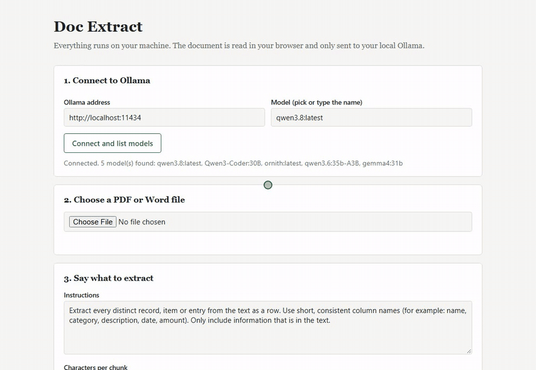

# Doc Extract

Extract tabular data from PDF or DOCX files into CSV using a local [Ollama](https://ollama.com) model. Everything runs locally: the document is parsed in the browser and only sent to your Ollama server.



<sub>The model call is fast-forwarded in the demo. [Full-quality MP4](docs/demo.mp4) · [Sample PDF](scripts/demo/sample-invoice.pdf) · [Resulting CSV](docs/demo-output.csv)</sub>

## Run

```bash
npm install
npm run dev        # http://localhost:5173
```

Other scripts: `npm run build` (type-check + production build to `dist/`), `npm run preview`, `npm test`.

If the model list stays empty, restart Ollama with browser access allowed:
`$env:OLLAMA_ORIGINS="*"; ollama serve` (PowerShell) or `OLLAMA_ORIGINS="*" ollama serve` (macOS/Linux).

## Re-recording the demo

`npm run demo` drives the app with Playwright and writes `docs/demo.mp4` and `docs/demo.gif`. It needs Ollama running, the model in `DEMO_MODEL` (default `qwen3.6:35b-A3B`), and ffmpeg on PATH (or set `FFMPEG=path/to/ffmpeg`).

## Structure

```
src/
  main.tsx                  React entry point
  App.tsx                   Wires hooks to panels
  config.ts                 Defaults: Ollama URL, chunk size, prompts, model options
  types.ts                  Shared types (Row, Table, Status)
  services/
    ollama.ts               Ollama HTTP client (list models, extract a chunk)
  lib/                      Pure, framework-free logic (unit tested)
    extractText.ts          PDF (pdf.js) / DOCX (mammoth) → text, lazy-loaded
    chunkText.ts            Split text into model-sized chunks
    parseRows.ts            Tolerant JSON → rows, table building
    csv.ts                  CSV serialization and download
    lib.test.ts
  hooks/                    State + side effects
    useOllamaConnection.ts
    useDocumentText.ts
    useExtraction.ts        Chunk loop, progress, cancel, raw log
  components/               Presentational UI
    ConnectionPanel.tsx  FilePanel.tsx  ExtractionPanel.tsx
    ResultPanel.tsx  DataTable.tsx  HelpPanel.tsx  Section.tsx  StatusMessage.tsx
  styles/global.css
```
